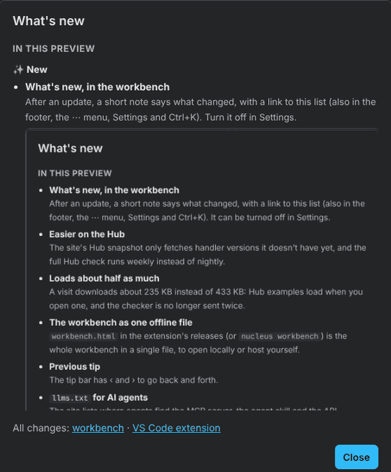
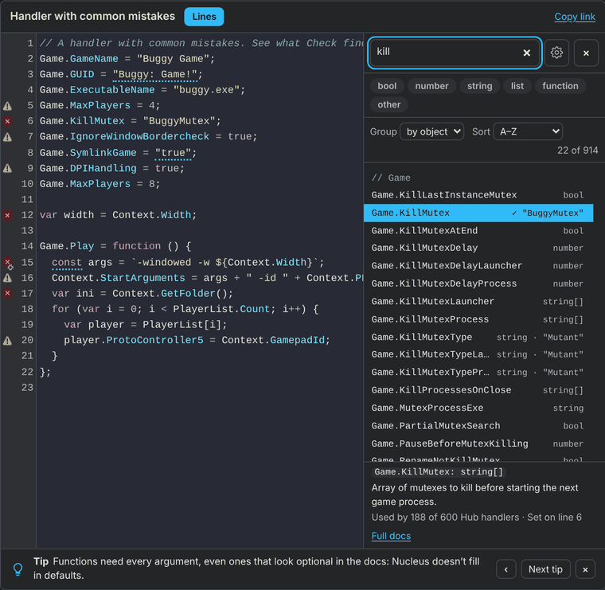
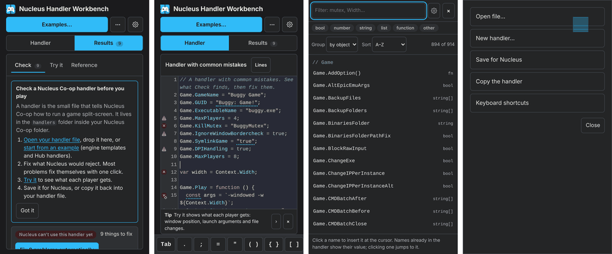

# Changelog

What changed in the browser workbench (<https://snailedlt.github.io/nucleuscoop-handler-testbench/>). It updates whenever `main` changes, so releases are dated. Newest first. The workbench shows this list itself under **What's new**.

<!--
How to write it (people and AI agents read this, and the workbench shows it):
- Add each user-visible change under "## Unreleased", in one of these groups, biggest change first:
  ### ✨ New · ### 🛠️ Improved · ### 🐛 Fixed · ### ⚡ Faster · ### ⚠️ Changed (what users must do differently) · ### 🙏 Thanks
- 🙏 Thanks: one line per person who tested, reported a bug or contributed to this release, e.g. "- **Horah** for reporting …". When it came through GitHub (an issue, a pull request, a review), link their profile: "- **[name](https://github.com/name)** for …". Credit them inline too ("Reported by Horah.").
- One line per change: a **short summary** in bold (the update note shows only that), then one or two plain sentences.
- A screenshot for big, visible changes, indented under its line: `  ` (≈700–1000 px wide).
- When it goes live: rename "## Unreleased" to "## <yyyy-mm-dd>" (add " HH:MM", UTC, for a second release on the same day). A `---` line separates releases.
-->

## Unreleased

### ✨ New

- **System.IO and other .NET calls in Lines.** `System.IO.File.Copy`, `Exists`, `Delete`, `Path.Combine`, `Directory.CreateDirectory`, `Thread.Sleep` and more, with docs, completion and how many Hub handlers use them. Suggested by messenils.
- **WakaTime, if you use it.** Add your API key in Settings › Advanced and the time you spend on handlers shows up in your WakaTime dashboard (or a self-hosted Wakapi). Only the file name, the game name and the time are sent, never the code; it's off until you turn it on.
- **VS Code's shortcuts in the editor.** Ctrl+/ comments a line, Alt+↑/↓ moves it, Shift+Alt+↑/↓ copies it, Ctrl+Shift+K deletes it, Ctrl+D selects the next match, Alt+click adds a cursor, Ctrl+F / Ctrl+H / Ctrl+G find, replace and go to a line, and Ctrl+. shows the fixes for a line. Ctrl+P and F1 open the examples and actions, Ctrl+S saves for Nucleus, Ctrl+B shows Lines. Press ? for the full list.
- **Lines as a tree.** Group › as a tree starts at Game, Context, Player, System and Nucleus; tap one to go a level deeper (System › IO › File), and back with the path at the top. With the list wider (Settings › Lines › Wider column, or drag its edge), it shows two columns, like a file browser. Typing a filter still searches everything. Idea: messenils.

### 🛠️ Improved

- **One Settings window, with tabs.** General, Editor, Lines, Help and Advanced; the Lines list's ⚙️ opens it on the Lines tab, so every setting is in one place.
- **The logo goes home.** Clicking the logo or title opens the Nucleus Handler Tools start page, with the VS Code extension and how to install it.
- **A misspelled function is an error, not a skipped setting.** Calling a name that doesn't exist stops Nucleus, and Check now says so.

### 🐛 Fixed

- **Lines writes functions as functions.** Clicking Game.Play, Game.OnStop and other callbacks inserts `Game.Play = function () { … };` with the cursor inside, instead of `Game.Play = ;`. Reported by messenils.
- **Packages keep their other files.** Opening a .zip or .nc with more than handler.js (Goldberg files, configs, DLLs) and saving it again used to drop them. Now they're kept, shown as "+ 3 files" next to the name, and saved back unchanged in .zip and .nc.

### 🙏 Thanks

- **messenils** for the System.IO lines, the tree idea and reporting how Lines inserted Game.Play.

---

## 2026-11-05 18:33

### ✨ New

- **Tap a warning next to the code.** Its problem opens right there, with Fix this. Works on phones too, where there's no hover.
- **Problems under the code on phones.** A strip shows how many problems there are and steps through them (‹ ›), so you can fix things without switching to Results.
- **Docs for each name in Lines.** The (i) button opens what a name does, its default and how many Hub handlers use it, with Insert and Full docs.
- **Test all combinations in Try it.** One button runs every player count (up to the handler's maximum), input setup and monitor size, and shows which combinations fail and why. Pick a cell to see that run. It takes about half a second.
- **Copy or download right next to the code.** The new button beside Lines copies the code or a link, or downloads the handler as a .zip for Nucleus, a plain .js or an .nc package. Open a file from your device straight from the handler's name. While typing on a phone, Copy… in the symbol keys does the same. On phones, a link opens on the handler, and the phone's own Select all, copy and delete reach every line.
- **Try it with a keyboard and mouse for every player.** Choose "Each player their own" under Keyboard & mouse, as in Nucleus' multiple keyboards and mice mode. Try it says so when the handler doesn't support it.

### 🛠️ Improved

- **Resize the panels.** Drag the edge between the code and the results, the left edge of the Lines list, or (on phones) the top of the Lines sheet. Double-click an edge to reset it, or use Settings › Reset panel sizes. Sizes are kept in your browser.
- **Much more room on phones.** All the buttons share one row at the bottom, in thumb reach (Handler and Results, the menu, Settings), hidden while you type, and Lines opens as a sheet over the lower part so the code stays in view.
- **The line you type stays in view on phones.** When the on-screen keyboard opens, the workbench fits the space above it (it reads the keyboard's height): the header and the tip bar step aside, and the cursor line stays visible above the symbol keys.
- **The symbol keys always sit just above the keyboard.** When the browser can't tell how tall the on-screen keyboard is (some browsers, or the workbench inside another page), they use the height measured last time on that phone, or a careful estimate.
- **Phone-friendly menus.** The menu, Settings and other dialogs rise from the bottom as sheets, as tall as their content; drag one down or tap outside to close. Settings has bigger rows, a one-tap theme switch and Done always in reach. The examples list no longer pops up the keyboard or shows keyboard hints.
- **Tidier tips on phones.** One line with a large ×; tap it for the whole tip, back, next and Turn off.
- **Switch handlers from the handler's name.** Click the name above the code to open an example or a Hub handler. It replaces the Examples button.
- **Docs and problems by tap on touch screens.** Tap an underlined word to see its problem and fix; the docs of the name under the cursor show under the code. Holding still selects text as usual. Hold a button to read what it does without pressing it. The mouse-only pop-ups no longer get stuck on phones.
- **More tips, on both handlers and the workbench.** Next now takes turns between a tip for writing handlers (when `Game.Play` runs, per-player launch arguments, `Game.Folder` and more) and one for the workbench (Test all combinations, resizing panels, the (i) in Lines and more).
- **The developer bar fits on phones.** One scrollable row at the top instead of three rows over the page.
- **The verdict comes first.** Check opens with whether Nucleus can use the handler and the fix button; the welcome note is a short card under it, with a × to dismiss.
- **Try it helps when the handler doesn't load.** Fix the problems from there with one click, or jump to them.
- **More room for the code.** The Lines list opens by default only on very wide screens (1680 px and up), and the code gets more of the width while it's open.
- **A shorter Try it intro.** One sentence instead of a paragraph.

---

## 2026-11-05 15:43

### ✨ New

- **What's new, in the workbench.** After an update, a short note says what changed, with a link to this list (also in the footer, the ⋯ menu, Settings and Ctrl+K). Turn it off in Settings.
  
- **The workbench as one offline file.** `workbench.html` in the extension's releases (or `nucleus workbench`) is the whole workbench in a single file: open it locally or host it yourself.
- **`llms.txt` for AI agents.** It tells agents where to find the MCP server, the agent skill and the API reference, and asks them to run the tools themselves instead of using this site.

### 🛠️ Improved

- **Go back a tip.** The tip bar has ‹ and › to go back and forth.

### ⚡ Faster

- **Loads about half as much.** A visit downloads about 235 KB instead of 433 KB: Hub examples load when you open one, and the checker is no longer sent twice.
- **Easier on the Hub.** One daily job is the only thing that reads the Hub's list; everything else (the site, the weekly check, people's tools) reads our copy of it. Only new handler versions are downloaded, the full Hub check runs weekly, and the site is only redeployed when something changed.

---

## 2026-11-05

### ✨ New

- **Lines list beside the code.** Every name a handler can use, click to insert. It shows what the handler already sets (and jumps there instead of adding a second line), dims names that don't work where the cursor is, suggests values, and sorts by how many of the 600 Hub handlers use each name. Its ⚙️ has the list settings. Idea: messenils.
  
- **Tips while you write.** Loading-screen-style tips under the code, and a heads-up when the code makes one relevant (each shown once). Turn them off with ×.
- **Settings.** ⚙️ in the header: theme, text size, line wrap, symbol keys, tips and the Lines list; Advanced mode and the developer bar under Advanced.
- **Works on phones.** A slim header with a ⋯ menu, Lines full screen, wrapped lines and symbol keys above the on-screen keyboard.
  
- **Intro page for testers.** [The intro page](https://snailedlt.github.io/nucleuscoop-handler-testbench/start/) has screenshots, the install guide and a download link that always points to the newest release.

### 🐛 Fixed

- **The Lines scrollbar no longer hides values.** On Windows it covered the values on the right. Reported by Horah.
- **Two false flags gone.** Found by checking all 600 Hub handlers: a syntax error on `let x` followed by `var x`, and a Proto Input warning on 11 handlers.

### 🙏 Thanks

- **messenils** for the idea of a list of every name, like Pawno's.
- **Horah** for reporting the scrollbar that hid values.

---

## 2026-11-02

### ✨ New

- **The workbench on GitHub Pages.** Rebuilt daily with the newest verified Hub handlers.
- **Share links.** Copy link puts the handler (or the selected lines) in the address.
- **The splitscreen.me look.** Light and dark.
- **Weekly check against the real engine.** Every verified Hub handler runs in Nucleus' script engine (Jint 2.11.58) and is compared with Try it.

---

## 2026-11-01

### ✨ New

- **First version.** Check a handler, fix it automatically, and Try it: what Nucleus sets up for each player.
