# Changelog

What changed in the browser workbench (<https://snailedlt.github.io/nucleuscoop-handler-testbench/>). It updates whenever `main` changes, so releases are dated. Newest first. The workbench shows this list itself under **What's new**.

<!--
How to write it (people and AI agents read this, and the workbench shows it):
- Add each user-visible change under "## Unreleased", in one of these groups, biggest change first:
  ### ✨ New · ### 🛠️ Improved · ### 🐛 Fixed · ### ⚡ Faster · ### ⚠️ Changed (what users must do differently) · ### 🙏 Thanks
- 🙏 Thanks: one line per person who tested, reported a bug or contributed to this release, e.g. "- **Horah** for reporting …". When it came through GitHub (an issue, a pull request, a review), link their profile: "- **[name](https://github.com/name)** for …". Credit them inline too ("Reported by Horah.").
- One line per change: a **short summary** in bold (the update note shows only that), then one or two plain sentences.
- A screenshot (or other media) for big, visible changes, folded away in a `

Screenshot
` block indented under its line, with a blank line before and after the image and the closing `  
`; the image line: `  ` (≈700–1000 px wide), with `<date>-<name>-dark.png` beside it: What's new shows the one for the viewer's theme (`tools/screenshots.cjs` takes both). An animation is a `.gif` (or `.mp4`/`.webm`, smaller) with a `.png` still of the same name beside it (`x-light.gif` + `x-light.png`, and the dark pair): What's new shows the still until the item is opened, then plays it, unless the device asks for less motion. Keep each under ~300 KB; summary `Animation`.
- When it goes live: rename "## Unreleased" to "## <yyyy-mm-dd>" (add " HH:MM", UTC, for a second release on the same day). A `---` line separates releases.
-->

## 2026-11-09

### ✨ New

- **Notepad++ code colours.** *Settings › Theme and colours › Code colours* now has Notepad++: bold blue keywords, bold navy operators, green comments, and its dark mode's colours in dark (strings, numbers and dark comments adjusted a little for 4.5:1 contrast). VS Code's (Light+ / Dark+) is there too; point at a card to see what it is.
- **Suggestions as smart as VS Code's.** The code editor now suggests your own functions and variables (with their comments), the keys your `Game.AddOption` lines add after `Context.Options["` and their values after `== "`, snippets for what most handlers do (`iniset`, `startargs`, `eachplayer`…) and, in an empty file, the whole handler template; Tab moves through the parts to fill in. The highlighted suggestion's docs show beside the list, parameter hints say what to pass, and hovering your own function shows its comment.
- **Credit lines on handlers made here.** A handler made or changed in the workbench gets a few comment lines at the top when you save or copy it: made with the workbench (with a link), and plainly what was and wasn't done here (checked, simulated with Try it on this version, changed by Fix with AI), so people helping you see which tools were used. A handler you only opened and saved stays as it was; opened again, the lines are folded away. In Advanced mode, Settings › Feedback and privacy can turn them off.
- **Fold code blocks, as in VS Code.** Arrows next to the line numbers (on hover) fold functions, `if` blocks, lists and runs of comments; Ctrl+Shift+[ / ] folds or unfolds the block around the cursor, Ctrl+K Ctrl+0 folds all, Ctrl+K Ctrl+J unfolds all. In the code, Ctrl+K now starts these two-key shortcuts; Open is Ctrl+P (Ctrl+K still opens it elsewhere).
- **Coding keys as in VS Code.** Tab now indents a selection instead of replacing it; F2 renames a variable or function everywhere (every use selected, type the new name); Shift+F12 selects all its uses; Ctrl+Shift+L selects every occurrence; Ctrl+K Ctrl+C / Ctrl+K Ctrl+U comment and uncomment lines; Shift+Alt+A toggles a block comment; Ctrl+Shift+\\ jumps to the matching bracket; Shift+Alt+I puts a cursor at the end of each selected line; Ctrl+↑/↓ scroll. In the code, Ctrl+Shift+L is VS Code's (Lines is Ctrl+B).
- **Find and replace, go to line and run keys as in VS Code.** Ctrl+F opens a find box at the top right with the match count, match case / whole word / regex (Alt+C / W / R), and Ctrl+H adds replace (Enter replaces one, Ctrl+Alt+Enter all). Ctrl+G goes to a line (`42` or `42:7`). Try it is now Ctrl+F5 (VS Code's Run Without Debugging) and Test all Ctrl+; then A (Run All Tests); Ctrl+Enter adds a line below, as in VS Code.
- **Change any shortcut.** *Settings › Keyboard shortcuts* lists every shortcut (searchable): click Change and press the new keys (two in a row for a two-step one). Clashes are pointed out and moved, keys the browser keeps (Ctrl+W…) are refused, and Reset puts one or all back. The shortcut list (?) and the command palette show your keys, and *Export settings* takes them to another browser.
- **Shortcuts on every keyboard layout.** Shortcuts with `[ ] / \\ ;` go by the key's position, as in VS Code, so they work on German, Spanish, Portuguese, Nordic and other keyboards where those characters sit elsewhere (on German, Ctrl+- comments a line); AltGr still types them.
- **Go to definition (F12).** On a function or variable of the handler, F12 jumps to where it's declared; on `Game.Play` (or any option) to where it's set; on `Context.Options["key"]` to its `Game.AddOption`. Also in the command palette.
- **Common JavaScript mistakes caught.** Check now includes ESLint's rules for real bugs: `=` where `==` was meant, a backslash that disappears from a Windows path (`"C:\Games"`), the same key twice, code that never runs, a line that does nothing, and more, each explained in plain words.

### 🛠️ Improved

- **A clear privacy switch.** Settings › Feedback and privacy now has a Privacy section with one switch for the anonymous usage counts (GoatCounter), what they are in plain words, and links to the public numbers and the open-source code that sends them. Opening the workbench with `#toggle-goatcounter` at the end of the address also turns them off for that browser.
- **The UI kit and the Duo and Nucli overview are online.** Their links from the mascot pages led to a "404" (and *Overview* to the workbench): they're now at `/ui-kit/` and `/duo-nucli/`.
- **Short demo videos.** The start page shows the workbench, VS Code and Notepad++ in a minute or two each (captioned, no sound).
- **Compare the editors.** The start page has a table of what VS Code, Notepad++, the workbench and other editors (through `ncdev lsp`) can each do.
- **Every editor on the start page.** *Works in your editor* shows VS Code, Notepad++ and the browser, and for experienced developers the editors that can use the language server (Neovim, Helix, Sublime Text, Emacs, Kate, JetBrains IDEs, Zed), each with its icon and how much setup it takes.
- **Old links keep working.** A link from before a change (an old `#reference-…` from before Docs) opens the same thing and says it moved; a link to something that isn't here any more says so and offers the way on (a Hub handler not among the examples opens on the Hub).
- **Neater code in the docs.** Examples and long signatures are laid out the way prettier would: one parameter, array item or argument per line when they don't fit, a last list hugged by its call (`f(a, b, [` … `])`), long `+` chains broken after `=`. Short code stays on one line, and nothing about what the code does changes.
- **Word wrap everywhere, as in VS Code.** *Settings › Wrap long lines* (or **Alt+Z**, also in the command palette) now applies to every place code shows: the handler, the package's files, hovers, Docs, Check, the debugger. Wrapped lines keep their indent, like VS Code's. With it off, long lines scroll sideways and are never cut off.
- **Package files in colour everywhere.** *Show the package's files* (Ctrl+K) now shows INI, CFG, JSON and XML in the code colours, as the Files panel's editor already did.
- **Link to a part of the start page.** Point at a heading and click the 🔗 next to it (always shown on phones): the address gets the section's name (`#what-it-catches`, `#try-it-in-5-minutes`), ready to paste, like on GitHub. Old links such as `#install` still work.
- **Reference is now Docs, with links you can share.** The tab is called Docs, and the address follows it: `#docs-Context.ModifySaveFile` opens that name, `#docs-Context` the Context list, so a link to a doc can go in Discord. A quiet path at the top (*Docs / Context / ModifySaveFile*) takes you to the main page or the whole list in one click, ← (or Alt+←) goes back, and names in the docs open their own page.
- **Hovers and hints like VS Code's.** The hover over code is now one small flat box above the line: each problem in a line or two, the docs under a thin divider, the fixes as links at the bottom. Parameter hints sit just above the line you type, show one overload at a time (1/2, Alt+↑/↓) and what to pass. Suggestions are denser, with the typed letters highlighted and the signature on top of their docs. Every API name in them is a link: click it (or Enter) to open it in Docs.
- **Expert settings only in Advanced mode.** Settings shows newcomers only what they need: credit lines, the developer bar, WakaTime and the Lines list's finer controls now appear (marked *Advanced*) when Advanced mode is on. Nothing changes value when it's hidden, and WakaTime stays in view while it's on.
- **Anonymous counts include screen size, language and where people come from.** When sharing counts is on (Settings › General), each count now also says the screen size, the browser's language and the site the visit came from (just the site, e.g. discord.com), so we can see what to design for and where people find the workbench. Still no code, names or cookies.
- **JavaScript's own methods in suggestions.** After a string (`Context.StartArguments.`), a list, `Math.` or `JSON.`, suggestions and hover cover JavaScript's built-in methods, only the ones Nucleus's engine has.

### 🐛 Fixed

- **The workbench always starts.** Now and then (when the first tip was the one about sharing) the page stopped while starting: no handler, and Settings did nothing.
- **Save is readable in every look.** In the Mac and alpha 8 looks the Save button's text was nearly invisible.
- **"I write code" starts compact.** That first-visit answer now also turns tips off and skips the Getting started banner (both stay in Settings and the footer).
- **Lines waits to be asked.** On wide screens the Lines list no longer opens by itself; Lines or Ctrl+B opens it, and it stays as you leave it.
- **Share links say what they leave out.** A link carries the code only; with package files it now says so and how to share them (Save ▾ › .zip).
---

## 2026-11-08

### ✨ New

- **Fix with AI, with the AI you choose.** Settings › AI: Claude on claude.ai as before, the Anthropic API or OpenAI with your own key, or any OpenAI-compatible service: OpenRouter, Google Gemini, or a free model on your own PC with Ollama or LM Studio. Keys stay in your browser and go only to that provider; the code is sent only when you press Fix with AI.
- **Save straight into Nucleus Co-op.** Ctrl+Alt+S (or Save ▾ › Into Nucleus Co-op) writes the handler and its files into Nucleus' handlers folder, laid out the way a Hub install does it. Pick the folder once and it's remembered. Chrome and Edge only; Firefox and Safari save the .zip, which you drag onto Nucleus' window.
- **Pick a value instead of typing it.** Put the cursor on a value like the `false` in `Game.SymlinkGame = false;` and a small ▾ appears after it (Alt+↓ from the keyboard): it lists what the option takes, true or false, its choices, or − and + for numbers. A value of the wrong kind, like `"true"` in quotes, says so and offers the right one. Suggested by messenils.

### 🛠️ Improved

- **Every Hub handler, not just 600.** The Hub's handler list stops at the 600 with the most stars; the daily sync now also reads the rest the way the Hub's own website does, so Open (Ctrl+K), the checks and the counts see all of them (about 900).
- **Fewer false alarms on package files.** Keys set twice in an INI file are fine now (Unreal Engine games list values that way), and a file the handler uses but the package doesn't have is only flagged when it looks like a typo, since many handlers download or create files when they run. The same checks now run in VS Code too.

### 🙏 Thanks

- **messenils** for the idea of picking values like in the old game editors.

---

## 2026-11-07 21:41

### 🛠️ Improved

- **A note for phones before reporting.** On a phone, Tell us what's wrong and Help test this beta say to open GitHub in the browser: the GitHub app leaves out the form and the details the workbench filled in.

---

## 2026-11-07

**The biggest workbench update yet.** Step through a handler line by line, build one with Form and Blocks instead of code, open whole packages (Hub handlers too, with all their files), and work on several handlers at once. Plus Settings with search and Accessibility, Nucli and Duo, and a lot of polish. Testing the beta? Thank you! Help test this beta (at the bottom) has what to try, and you can compare with the previous version.

### ✨ New

- **Step through a handler, and back.** Click beside a line number for a breakpoint, then Try it › Step through (F5): it pauses there for each player, says in plain words where it is, highlights the line, and shows the variables, Context, the options set so far and what Nucleus would have done up to that point. Next line (F10), Back (Alt+F10) and a timeline go through the whole run; Advanced mode adds Step into/out, watches, the call stack and conditional breakpoints.
  

Screenshot

  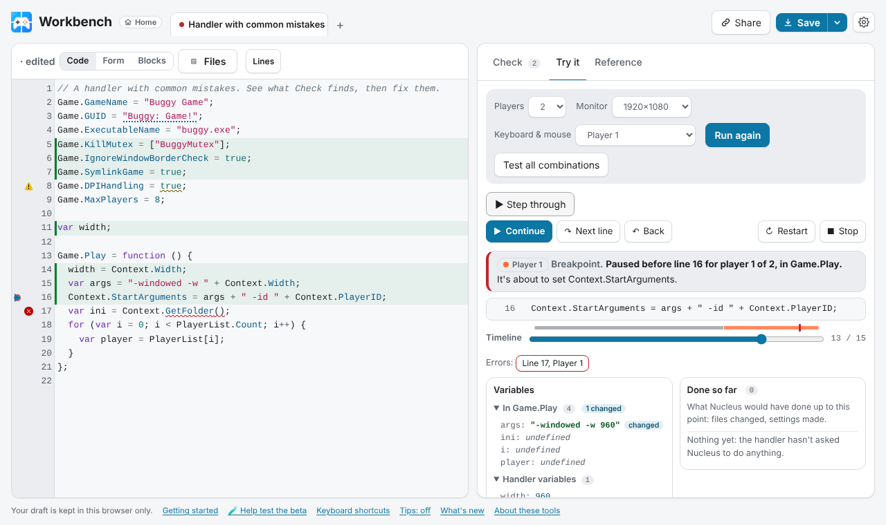

  

- **Form and Blocks: a handler without writing code.** Next to Code, **Form** shows the options as switches, lists and fields, and **Blocks** shows Game.Play and the other callbacks as plain steps ("If … then", "Set … to", "Do …") with pickers for values and conditions. Each shows one line per option or step, with its main problem and a Fix button; the arrow opens the rest. Every change edits the code itself, comments stay, and Lines adds options and steps there too.
  

Screenshot

  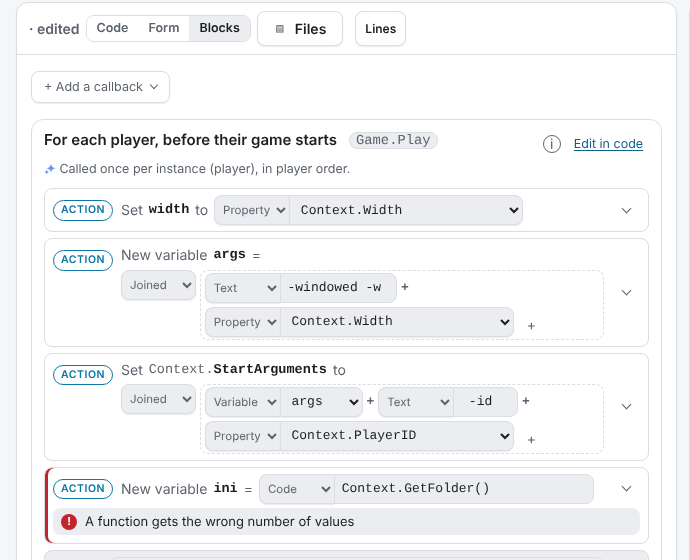

  

- **Whole packages, Hub handlers included.** Files (above the code) shows a .zip or .nc as Nucleus installs it: open its ini, cfg, json, xml, txt or bat files in tabs with highlighting and checks, add and remove files, and save the whole package. Hub handlers that ship files open with all of them (the Open list says "+ N files"); big ones show their size and a link to the Hub package. Check warns about files a Hub install drops and files the handler uses that aren't there.
- **Several handlers at once.** Open handlers are tabs above the code, each with its own code, undo history, package files and a dot for its state (red: Nucleus can't load it, yellow: warnings, green: ready). Opening something while your handler has changes opens it in a new tab instead of replacing your work; closing one can be undone. Ctrl+Shift+[ and ] switch, Alt+W closes. On phones, the handler's name switches between them.
- **Your game on this PC.** In Files, link the folder your game is installed in: Check then compares `ExecutableName`, `BinariesFolder` and the symlink options with the real files, and those lists get a picker for the game's files. Only names and sizes are read, in your browser. Suggested by messenils.
- **Save and Share are two buttons.** Save (Ctrl+S) downloads straight away, as a .zip for Nucleus unless you pick .js or .nc under its arrow (Ctrl+Shift+S), and shows how to install it the first times. Share copies a link, the code, or a Discord-ready code block.
- **Settings, rebuilt, with Accessibility.** Sections in a sidebar and a search box that finds any setting. The new Accessibility section has colour-blind-friendly colours, other underlines for problems, a strong focus ring, larger buttons, an easier-to-read font, notes that stay until you close them, and problems read out as you move. Export your settings to a file and import them elsewhere.
  

Screenshot

  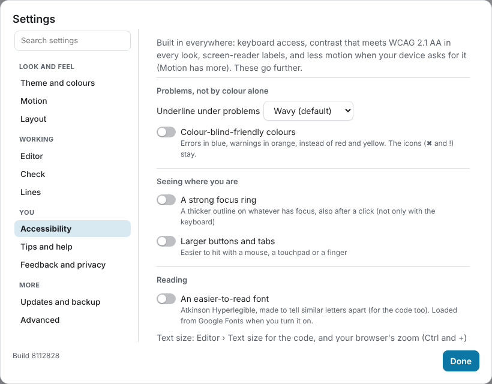

  

- **Make the layout yours.** A slim bar on top or a side rail (› shows its labels), Files and Lines on either side of the code, and every panel edge draggable.
- **Lines: a tree by default, grouped your way.** View picks Tree (open one group at a time, the default) or List (everything with headings), and Group sorts names by object, topic, type, or where they work (top level or inside Game.Play and other callbacks), in either view.
- **Check the AI-written docs.** Reference › "Help check AI-written docs" lists every doc AI wrote from the Nucleus source that no person has checked yet. Confirm one with 👍, or 👎 and "Tell us what's wrong"; checked ones say who checked them.
- **Window messages by name.** In `Game.ProtoInput.BlockedMessages`, each number shows its name (`0x0008` WM_KILLFOCUS), hovering one says what blocking it does, and a **+** before the `]` lists the messages handlers block, most used first. Check now also tells you when Proto Input never starts, when blocked messages need the message filter hook, and when a setting needs another one turned on. Suggested by messenils.

  

Screenshot

  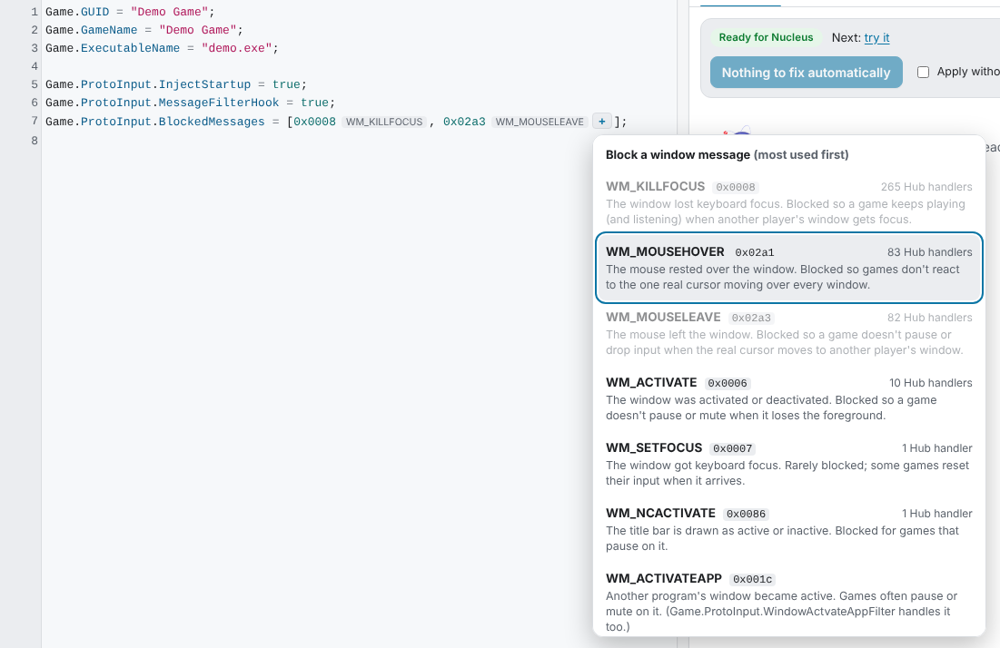

  

- **Help test this beta, first.** New visitors start with two quick questions (how much you code, how well you know Nucleus handlers) as big, easy choices, then get what to test: the items that fit you, quickest and most needed first, each with how long it takes. Your answers also pick guided or Advanced mode; Change brings the questions back, and Everything else lists the rest.
- **Compare with the previous version.** During the beta, Help test this beta (and the command palette) opens the handler you're on in the previous release, so you can say what got better or worse. It keeps its own settings and drafts.
- **Feedback that fills itself in.** Send feedback (menu and Ctrl+Shift+P), Report what you found and Tell us what's wrong now fill in the build, browser, screen, your settings and which handler is open (by name and link, never your code). A bot keeps that block as the issue's first comment, which only maintainers can change, and flags it if it was edited.
- **Tell us what helps.** 👍/👎 on tips, and on AI-written docs (with a link to say what's wrong). Votes are counted anonymously: no code, no names, no cookies; off in Settings › General, and off when your browser asks not to be tracked.
- **Nucli says hi.** On your first visit, Nucli asks two things: how much help you want (Guide me, or I write code for Advanced mode) and where the tools go (a slim bar on top, or a rail on the side, shown as you pick). Settings › Tips and help asks again.
- **Messages where it happened.** A quick fix, Format and F8 say what they did in a small note right under the line in the code, with Undo there too, instead of a note in the corner. Saving the .zip or creating a handler says what's next above the code (with a Try it button), and confirmations show on the button you pressed.

  

Screenshot

  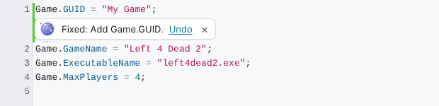

  

- **Duo and Nucli move in.** Nucli, the tools' quiet atom, is the workbench's: he dozes in Check until there's code, cheers when there's nothing to fix, runs Test all, reads along while Fix with AI works, spins while a Hub handler downloads, frets when something won't load and tells you how Try it went. Every spinner and loading state is his now. Duo, splitscreen.me's split-screen ball, greets you with him on the start page. Both follow Settings → Theme → Motion and stay out of the Nucleus Co-op alpha 8 look.

  

Animation

  

  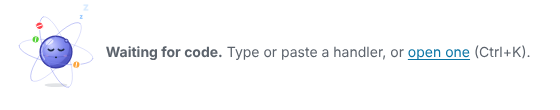

  

- **Duo and Nucli to download.** The mascot page (linked from the start page) has packs to take away: everything, Duo, Nucli, Discord emoji, loaders and spinners, avatars and a web kit, each with how to use it on a website or in an app.
- **Choose how much moves.** Settings → Theme → Motion: a preset (All, Default, Calm, Still, Off) and its switches: a moving interface, Duo and Nucli (lively, play once then rest, still or off), Nucli editing the code during fixes, and What's new playing animations by itself. Default keeps out anything that slows you down or covers the code; reduced motion on your device caps it at Still.

  

Screenshot

  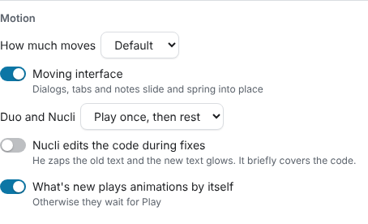

  

  

Animation

  

  

- **Nucli can fix it in front of you.** Turn on Settings → Theme → Motion → Nucli edits the code: when a quick fix, Fix all or Fix with AI changes the code, Nucli flies to each changed line and zaps it: the old text flashes red and shrinks away, the new text glows green. The edit itself happens at once, so typing and Undo are never held up. Off by default (it briefly covers the code): the changed lines just light up.
- **What's new can show animations.** An item can carry a GIF, a short video or an SVG (animated or not) as well as screenshots, in light and dark. It loads only when you open the item, then plays; if your device asks for less motion, it shows a still frame with a Play button instead. A button pauses it either way.

### 🛠️ Improved

- **Package files in colour, also in dark mode.** .bat and .cmd files, PowerShell scripts, Lua, .reg and Steam's .vdf and .acf files are highlighted like the rest, each with its own badge, and the editor for a package's other files follows the dark themes instead of staying white.
- **Engine probes, explained.** The tab now says what a probe is (a tiny handler run in Nucleus' real JavaScript engine), why it matters (the proof behind Check and Try it) and how to use it (look up whether Nucleus accepts some JavaScript, or ask for a new probe).
- **One handler per tab.** Opening an example, a Hub handler or a link always opens a new tab, and one that's already open switches to its tab (with Open a fresh copy if you changed it). With three or more tabs, ▾ lists them all.
- **Save in the side rail works like Save in the bar.** Right-click, Shift+click or a long press picks .zip, .js or .nc, and confirmations show on the button you can see in either layout.
- **Code in its colours everywhere, and real code editors in Form and Blocks.** Hover cards, Reference, Check's technical details, Try it, the debugger, What's new and the start page show code in your code colours. Code steps and code values in Blocks and Form are small code editors with suggestions, hover docs, squiggles, Shift+Alt+F and undo.
- **Long values fit in Form and Blocks.** Text fields grow to a few lines as you type, so a long `Game.Description` is readable in full; the expand button (or Alt+Enter) opens a larger editor with the option's docs, a dialog on phones.
- **Getting started where you start reading.** The "New here?" steps sit at the top of the code instead of in Check, and closing them is no longer forever: they fly down into Getting started in the footer (or the command palette), which brings them back.
- **Fixes go straight into the code.** Fix problems (and Fix with AI) apply right away and light up the changed lines in the editor; a one-line note has Undo, and what changed is folded under it. Only an AI fix that looks risky (new problems, a big rewrite, or you typed meanwhile) waits for you to apply it. "Apply without review" is gone.
- **A Home button by the title.** The title is the workbench's own link now, and Home next to it goes to the home page (what the tools do, how to get them).
- **Check fits more on screen.** Each problem is one row (its colour, line, what's wrong and the fix); click it for the why, other fixes and the technical details. Settings › General › Check switches to Comfortable or Detailed.
- **One box when you hover a problem.** The problem, its fixes (all of them: "set twice" lets you keep either value) and Ctrl+. come first; the name's docs fold away below it.
- **Reference entries stand apart.** Each name is its own card, and the `Hub.*` lines the Hub writes on upload are in Reference too (marked "written by the Hub"), with what Nucleus uses them for.
- **Nicer docs on hover.** The signature is coloured (name, parameters, types), defaults and categories are small labels, and AI-written docs say so at the bottom, with what they're based on. 150 more names have docs now.
- **Shortcuts where you look.** Hover a button (or reach it with Tab) to see its keyboard shortcut, also outside Advanced mode.
- **Tips point at the real button.** A tip about Lines, Try it or Save or copy highlights that button while it shows; the tip's own arrows are both ‹ and ›.
- **Suggestions after `=`.** Typing `Game.SymlinkGame = ` offers `true` and `false`, an option with fixed values lists them (`Nucleus.DPIHandling.…`), `Game.Play = ` writes the function with the cursor inside, and `Game.ProtoInput.BlockedMessages = ` offers the set most Hub handlers block.
- **Problems explained right where they are.** Hovering underlined code (or a marker in the margin) opens a card under it, not on top of it: an icon in the problem's colour, a plain title, the exact message with names shown as code, and the fix as a button you can click. The name's docs follow below.

  

Screenshot

  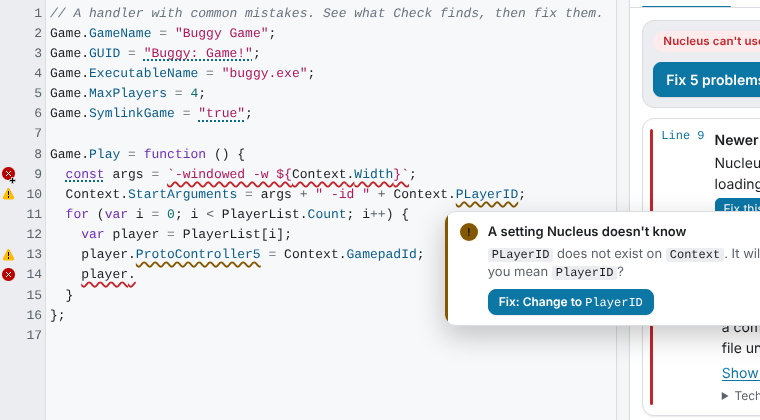

  

- **The colour glow is for AI only.** Pointing at an everyday button no longer makes it glow; only Fix with AI does.

### 🐛 Fixed

- **Share… on the phone keyboard row.** The key above the phone keyboard opened Save, which now saves straight away; it's Share… now, so a link to the selected lines is still one tap away.
- **Settings no longer empties the results.** Switching tabs in Settings left Check blank until you picked a tab again.
- **Keyboard users can leave the editor.** Tab still indents; Esc then Tab moves on to the rest of the page. Esc also closes a line's problem list, and Ctrl+. puts you on its Fix button.
- **Smaller fixes.** New handler starts empty (with examples as hints) instead of filled with Deep Rock Galactic; Try it offers up to your handler's `Game.MaxPlayers` players; Test all waits until the handler loads; the AI review's Accept and Reject sit above the changes; the shortcuts list opens at the top; no Fix button when there's nothing to fix; problem texts line up; on phones Lines no longer pops up the keyboard and the ⋯ menu skips keyboard shortcuts.
- **Red squiggles are back.** Problems are underlined again exactly where they are in the code (a thin VS Code-style wave: red for errors, yellow for warnings; dotted for tips); the style that drew them had stopped working.
- **A typo no longer hides every other problem.** While a line doesn't parse yet (say you're halfway through `player.`), the rest is still checked, and the error sits on the unfinished code instead of on the next line.

### 🙏 Thanks

- **messenils** for the idea of naming the window messages in `BlockedMessages`, picking the game folder to check paths, and a trigger-editor style way of editing handlers.

---

## 2026-11-06

### ✨ New

- **Two looks from Nucleus Co-op's past, and code colours of your choice.** **Mac style** looks like macOS, after vlxst's Mac style for Nucleus Co-op: panes as windows with traffic lights, a frosted toolbar over a wallpaper, segmented tabs, push buttons and system blue. **Nucleus Co-op alpha 8** is the original 2019 app: flat greys, square corners, white-bordered buttons and no animation. Both come in light and dark. Code colours are now their own choice, under the looks: the look's own, GitHub, VS Code, Xcode, One, Monokai or Dracula, each shown as a few lines of handler. All of it now has its own Theme tab in Settings.

  

Screenshots

  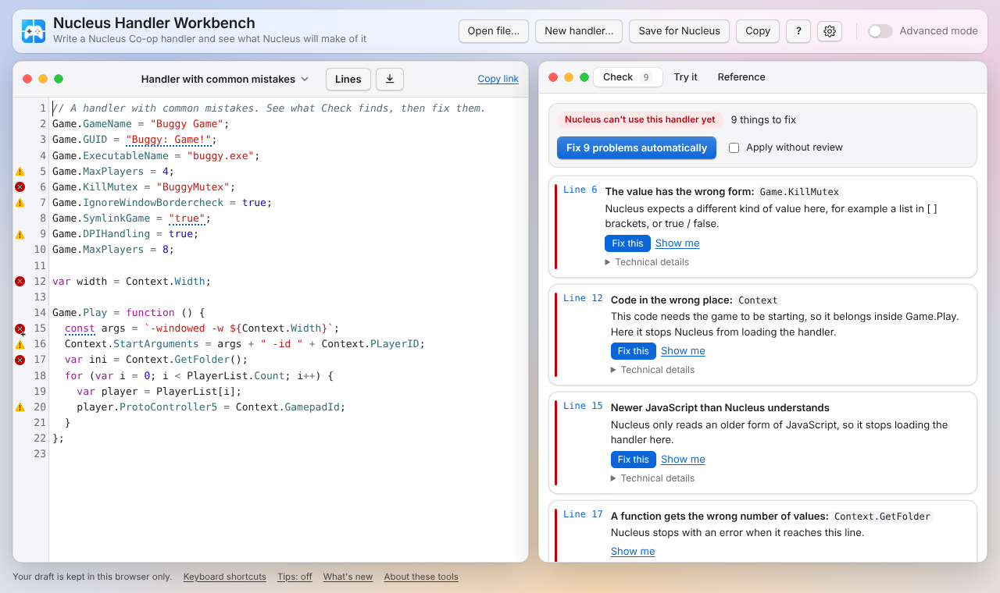

  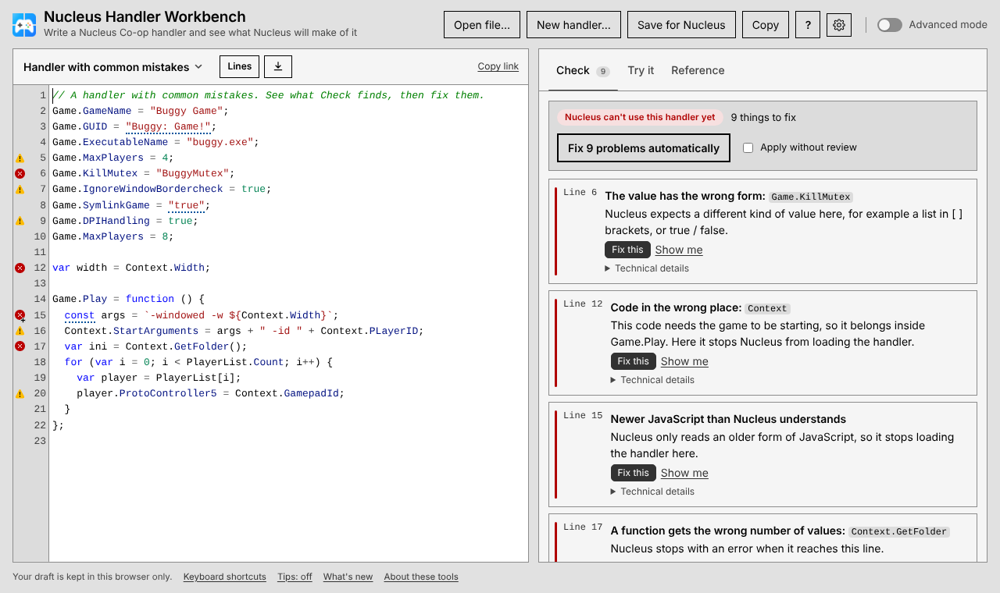

  

- **Livelier motion.** Inspired by BSManager: dialogs rise with a little spring, the main button glows in the player colours when you point at it, icons turn under the pointer, Open's rows show "Open →" as you move over them and arrive one after another, the marker under Check, Try it and Reference glides between tabs, and main buttons widen a little under the pointer. The start page fades in with a glow and its buttons widen too, after bsmanager.io. None of it plays if your device asks for less motion.
- **Feedback you can see and touch.** After the BSManager app: Test all shows a progress bar while it runs and the logo beats until it's done, a toast can be swiped away to the right (a short drag springs back), and a notice slides in at the top of the code instead of just appearing.
- **Every Hub handler, not just 40.** Open (Ctrl+K) lists all of the Hub's handlers, about 600, most downloaded first, each with its cover, players, downloads and a clean or warning badge; search finds any of them. They come from our own daily copy, so opening one never waits on the Hub, and the Hub only sees a few requests a day however many people use the workbench.
- **Pick a look, or make your own.** Settings → Theme → Look shows splitscreen.me, v3.splitscreen.me and your own theme files (JSON) as cards, each with a small picture of the workbench in its colours; "Add a theme file" is the last card. A theme builds on one of the built-in looks and only lists what it changes: colours for light and dark, plus corners, shadows and fonts for both; tiles, borders and status colours follow the colours it sets. "Download this look as a theme file" gives you a file to start from, and the workbench says which values it left out and which text gets hard to read. Keep as many as you like.

  

Screenshot

  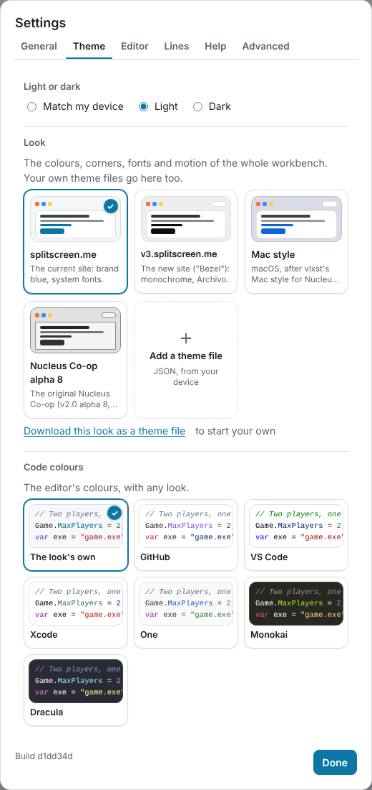

  

- **Reference shows what's in it.** With nothing typed, the Reference tab lists what you can look up: Game, Game.Hook, Context, Player, ProtoInput and .NET, each with a count (click one for all its names), the names Hub handlers use most, the Nucleus enums, and a few searches to try.
- **A sneak peek at Duo and Nucli.** The start page links to the mascots we're sketching for splitscreen.me (Duo) and these tools (Nucli): their animations, loaders and a concept for player setup in a future Nucleus Co-op. Early concepts; they'll move into the workbench soon.

### 🛠️ Improved

- **The logo takes you home.** Clicking it opens the start of the Open dialog (new handler, open a file, examples) instead of leaving the workbench. The start page, with the VS Code extension and how to install it, is now "About these tools" at the bottom (in More on phones, and in the command palette).
- **One look across the workbench and the start page.** Rounder panes, cards and dialogs with soft shadows, buttons that react when you point at them, Check cards with a rounded colour bar, Try it with one card per player (their colour by the name), switches in Settings, and dialogs that fade in (or slide up on phones). The sizes come from one shared scale, and nothing moves if your device asks for less motion. The v3 look is lighter in light mode, and its code has colours again: keywords, names, text and numbers each their own.
- **Lines shows docs in Reference.** With the Reference tab open on a wide screen, pointing at a name in Lines shows its full docs there, not squeezed under the list. Suggested by messenils.
- **A cleaner Open dialog.** Ctrl+K now opens a palette near the top of the screen: the start actions as tiles with icons, engine templates as chips, and Hub handlers as rows with the game's cover (from the Hub), players, downloads and a clean or warning badge (hover it to see what it means). Hub handlers sit in two compact columns on wide screens (about 14 at once on a laptop, 22 on a full-HD screen). Searching groups the results with a count and highlights what you typed, and the arrow keys move through every layout.

  

Screenshot

  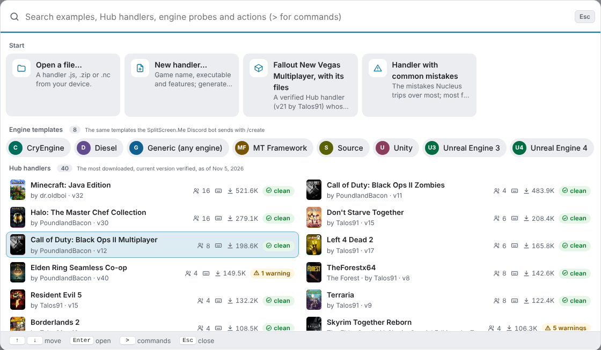

  

- **Numbered releases in What's new.** Each release shows its number, with a link to its notes on GitHub, and screenshots open only when you click Screenshot.
- **Problems stay where you can read them.** A link that opens nothing, a file or Hub handler that won't load, a failed save or a file Format can't read now shows at the top of the code until you close it or open another handler, with Try again where it helps. Copy and Copy link answer on the button itself ("Copied ✓"), and notes that only repeated what's on screen are gone.
- **Toasts in a stack.** Notes such as "Fixed" or "Link copied" pile up at the bottom right (above the bottom bar on phones): the newest in front, older ones peeking out behind it. Hover the stack to fan it out (it waits while you read), close one with ×, and use Undo on "Fixed" and "Formatted". Each shows whether it's good news or a problem.
  

Screenshot

  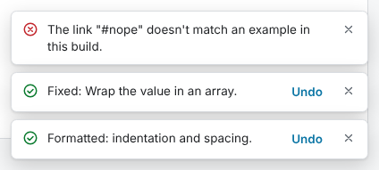

  

### 🐛 Fixed

- **The keyboard no longer covers search fields on phones.** Only the code made room for the on-screen keyboard; now everything does: Lines' filter, the Reference search, Open, New handler and the other sheets move up above it, and the field you tap stays in view.
- **Lines no longer flickers between two names.** Moving the pointer slowly over the list could make it jump back and forth between two rows, because the description under the list changed height. It now keeps one height, and Full docs has the rest. Reported by messenils.

### 🙏 Thanks

- **messenils** for the video of Lines flickering, the idea of showing its docs in Reference, and for spotting that `Game.SetupSse` is never called.

---

## 2026-11-05 23:00

### ✨ New

- **Command palette, as in VS Code.** Ctrl+Shift+P (or F1) lists every command with its shortcut: format, fix, Try it, Test all, go to line, download, theme, settings and more. Ctrl+P still opens the examples and Hub handlers, and typing `>` there switches to commands.
  

Screenshot

  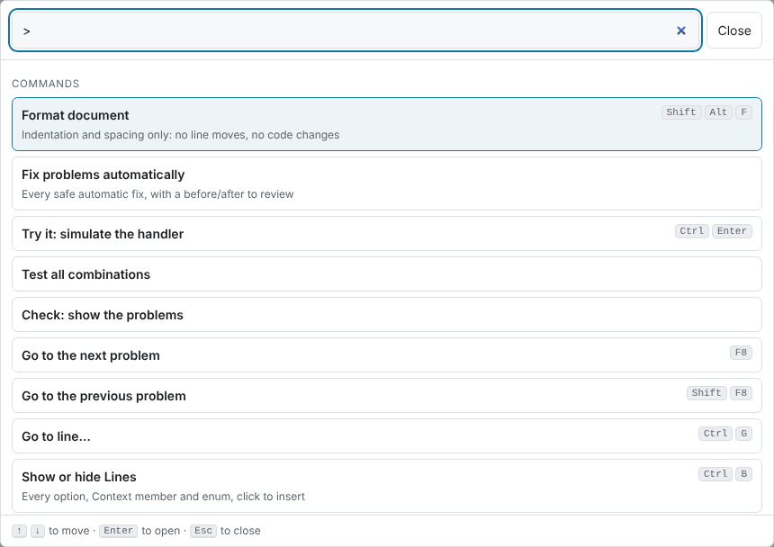

  

- **Format document.** Shift+Alt+F (or the command palette) tidies indentation and spacing. No line moves and no token changes, so Nucleus reads the handler exactly as before.
- **Tips for handler authors.** About 60 tips in five kinds, each labelled: best practices, common pitfalls, shortcuts, settings and features. Plus heads-ups for `Game.GUID`, `Game.AddOption` and `Game.CustomHotkeys` lines.
- **See what's in a package.** The "+ N files" next to the handler's name lists the package's other files, where Nucleus installs each one (`handlers\<GameName>\…`) and what's in the text files. To try it, open **Fallout New Vegas Multiplayer, with its files**, a verified Hub handler whose package adds the scripts its `Game.Play` runs.
  

Screenshot

  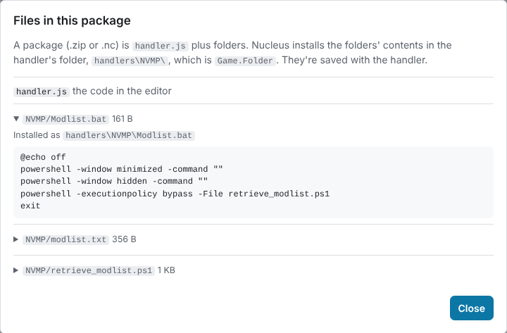

  

- **More checks from the Nucleus source.** Check warns when `Game.GUID` changed from the Hub version (players would lose the game and their profiles), when option values are `true`/`false` or numbers (a saved profile turns them into text), when the file isn't UTF-8, and when `Game.GameName` has a backslash (the Hub install fails).
- **Names that don't exist.** Check now catches a stray word or a typo of a variable (`"system.cfg", sdfsdf`), which stops Nucleus from loading the handler. Before, only Try it noticed. Plugins listed in a package's `pluginsInfo.txt` count as defined, in Check and in Try it.
- **System.IO and other .NET calls in Lines.** `System.IO.File.Copy`, `Exists`, `Delete`, `Path.Combine`, `Directory.CreateDirectory`, `Thread.Sleep` and more, with docs, completion and how many Hub handlers use them. Suggested by messenils.
- **WakaTime, if you use it.** Add your API key in Settings › Advanced and the time you spend on handlers shows up in your WakaTime dashboard (or a self-hosted Wakapi), as the Nucleus Workbench editor on your system, with a computer name you choose. Writing, testing in Try it and reading the docs count as separate categories, with line numbers and the lines you changed. Never the code; it's off until you turn it on.
- **VS Code's shortcuts in the editor.** Ctrl+/ comments a line, Alt+↑/↓ moves it, Shift+Alt+↑/↓ copies it, Ctrl+Shift+K deletes it, Ctrl+D selects the next match, Alt+click adds a cursor, Ctrl+F / Ctrl+H / Ctrl+G find, replace and go to a line, and Ctrl+. shows the fixes for a line. Ctrl+P and F1 open the examples and actions, Ctrl+S saves for Nucleus, Ctrl+B shows Lines. Press ? for the full list.
- **Lines greys out what doesn't work where you are, both ways.** Inside `Game.Play`, options Nucleus reads before the session (`Game.GUID`, `Game.MaxPlayers`, `Game.AddOption`...) are greyed out, with the reason; outside it, `Context` and `Player` are, as before.
- **Lines as a tree.** Lines now opens as a tree (Group › by object or by topic for the long list), starting at Game, Context, Player, System and Nucleus; tap one to go a level deeper (System › IO › File), and back with the path at the top. With the list wider (Settings › Lines › Wider column, or drag its edge), it shows two columns, like a file browser. Typing a filter still searches everything. Idea: messenils.

### 🛠️ Improved

- **The code editor is one stop for the keyboard.** Tab reaches the code once, and screen readers name it "Handler code".
- **Screenshots in your theme.** The pictures on the start page and in What's new are shown light or dark, following your system or the theme you picked in Settings.
- **Easier with a screen reader and a keyboard.** The code editor, the resize handles and the change list have names and positions screen readers announce, headings are in order, and a few low-contrast labels are darker.
- **Easier to find.** Clearer page titles and descriptions, link previews with a picture, and a sitemap for search engines.
- **One Settings window, with tabs.** General, Editor, Lines, Help and Advanced; the Lines list's ⚙️ opens it on the Lines tab, so every setting is in one place.
- **The logo goes home.** Clicking the logo or title opens the Nucleus Handler Tools start page, with the VS Code extension and how to install it.
- **A misspelled function is an error, not a skipped setting.** Calling a name that doesn't exist stops Nucleus, and Check now says so.
- **Game.ForceFinishOnPlay is flagged as historical.** It comes from the original Nucleus Coop; today's Nucleus doesn't read it and closes leftover copies of the game by itself. Check says so in a warning, with a fix that removes the line.

### 🐛 Fixed

- **No more "Save password?" from the browser.** The WakaTime key field was a password field, so picking a result in the Open dialog looked like a login to Chrome.
- **The fix box closes when you keep editing.** After Fix all, the before/after box stayed open with an old result while you typed; it now closes, and the list below shows what's left.
- **WakaTime shows the editor as Nucleus-Workbench.** It showed "Nucleusworkbench".
- **Lines writes functions as functions.** Clicking Game.Play, Game.OnStop and other callbacks inserts `Game.Play = function () { … };` with the cursor inside, instead of `Game.Play = ;`. Reported by messenils.
- **Packages keep their other files.** Opening a .zip or .nc with more than handler.js (Goldberg files, configs, DLLs) and saving it again used to drop them. Now they're kept, shown as "+ 3 files" next to the name, and saved back unchanged in .zip and .nc.

### ⚠️ Changed

- **Shift+Alt+F formats the code now, as in VS Code.** Fix all is in the command palette (Ctrl+Shift+P) and on its button.

### 🙏 Thanks

- **messenils** for the System.IO lines, the tree idea and reporting how Lines inserted Game.Play.

---

## 2026-11-05 18:33

### ✨ New

- **Tap a warning next to the code.** Its problem opens right there, with Fix this. Works on phones too, where there's no hover.
  

Screenshot

  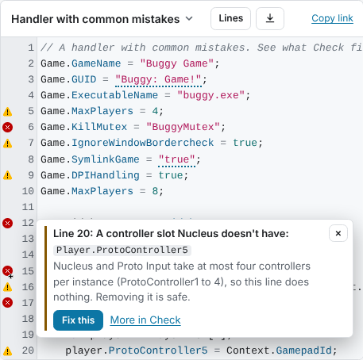

  

- **Problems under the code on phones.** A strip shows how many problems there are and steps through them (‹ ›), so you can fix things without switching to Results.
- **Docs for each name in Lines.** The (i) button opens what a name does, its default and how many Hub handlers use it, with Insert and Full docs.
- **Test all combinations in Try it.** One button runs every player count (up to the handler's maximum), input setup and monitor size, and shows which combinations fail and why. Pick a cell to see that run. It takes about half a second.
  

Screenshot

  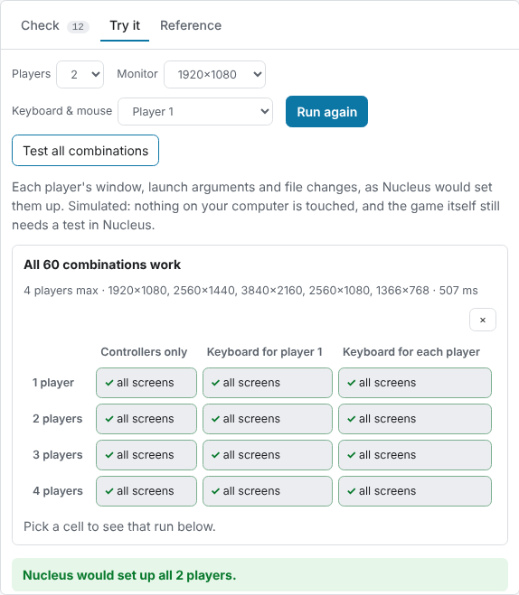

  

- **Copy or download right next to the code.** The new button beside Lines copies the code or a link, or downloads the handler as a .zip for Nucleus, a plain .js or an .nc package. Open a file from your device straight from the handler's name. While typing on a phone, Copy… in the symbol keys does the same. On phones, a link opens on the handler, and the phone's own Select all, copy and delete reach every line.
- **Try it with a keyboard and mouse for every player.** Choose "Each player their own" under Keyboard & mouse, as in Nucleus' multiple keyboards and mice mode. Try it says so when the handler doesn't support it.

### 🛠️ Improved

- **Resize the panels.** Drag the edge between the code and the results, the left edge of the Lines list, or (on phones) the top of the Lines sheet. Double-click an edge to reset it, or use Settings › Reset panel sizes. Sizes are kept in your browser.
- **Much more room on phones.** All the buttons share one row at the bottom, in thumb reach (Handler and Results, the menu, Settings), hidden while you type, and Lines opens as a sheet over the lower part so the code stays in view.
- **The line you type stays in view on phones.** When the on-screen keyboard opens, the workbench fits the space above it (it reads the keyboard's height): the header and the tip bar step aside, and the cursor line stays visible above the symbol keys.
- **The symbol keys always sit just above the keyboard.** When the browser can't tell how tall the on-screen keyboard is (some browsers, or the workbench inside another page), they use the height measured last time on that phone, or a careful estimate.
- **Phone-friendly menus.** The menu, Settings and other dialogs rise from the bottom as sheets, as tall as their content; drag one down or tap outside to close. Settings has bigger rows, a one-tap theme switch and Done always in reach. The examples list no longer pops up the keyboard or shows keyboard hints.
- **Tidier tips on phones.** One line with a large ×; tap it for the whole tip, back, next and Turn off.
- **Switch handlers from the handler's name.** Click the name above the code to open an example or a Hub handler. It replaces the Examples button.
- **Docs and problems by tap on touch screens.** Tap an underlined word to see its problem and fix; the docs of the name under the cursor show under the code. Holding still selects text as usual. Hold a button to read what it does without pressing it. The mouse-only pop-ups no longer get stuck on phones.
- **More tips, on both handlers and the workbench.** Next now takes turns between a tip for writing handlers (when `Game.Play` runs, per-player launch arguments, `Game.Folder` and more) and one for the workbench (Test all combinations, resizing panels, the (i) in Lines and more).
- **The developer bar fits on phones.** One scrollable row at the top instead of three rows over the page.
- **The verdict comes first.** Check opens with whether Nucleus can use the handler and the fix button; the welcome note is a short card under it, with a × to dismiss.
- **Try it helps when the handler doesn't load.** Fix the problems from there with one click, or jump to them.
- **More room for the code.** The Lines list opens by default only on very wide screens (1680 px and up), and the code gets more of the width while it's open.
- **A shorter Try it intro.** One sentence instead of a paragraph.

---

## 2026-11-05 15:43

### ✨ New

- **What's new, in the workbench.** After an update, a short note says what changed, with a link to this list (also in the footer, the ⋯ menu, Settings and Ctrl+K). Turn it off in Settings.
  

Screenshot

  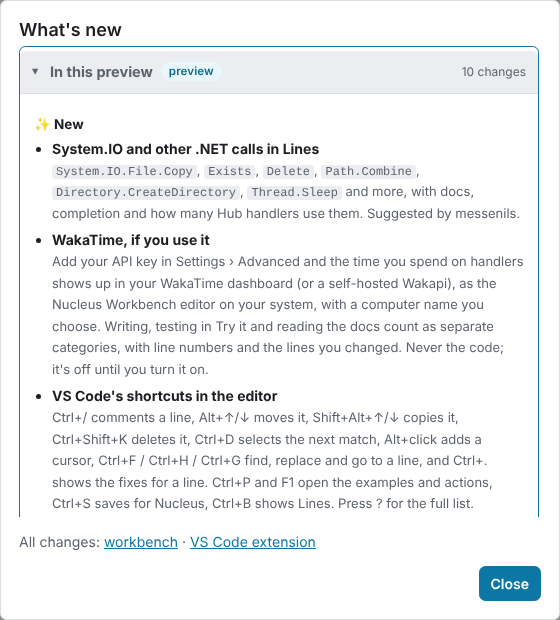

  

- **The workbench as one offline file.** `workbench.html` in the extension's releases (or `nucleus workbench`) is the whole workbench in a single file: open it locally or host it yourself.
- **`llms.txt` for AI agents.** It tells agents where to find the MCP server, the agent skill and the API reference, and asks them to run the tools themselves instead of using this site.

### 🛠️ Improved

- **Go back a tip.** The tip bar has ‹ and › to go back and forth.

### ⚡ Faster

- **Loads about half as much.** A visit downloads about 235 KB instead of 433 KB: Hub examples load when you open one, and the checker is no longer sent twice.
- **Easier on the Hub.** One daily job is the only thing that reads the Hub's list; everything else (the site, the weekly check, people's tools) reads our copy of it. Only new handler versions are downloaded, the full Hub check runs weekly, and the site is only redeployed when something changed.

---

## 2026-11-05

### ✨ New

- **Lines list beside the code.** Every name a handler can use, click to insert. It shows what the handler already sets (and jumps there instead of adding a second line), dims names that don't work where the cursor is, suggests values, and sorts by how many of the 600 Hub handlers use each name. Its ⚙️ has the list settings. Idea: messenils.
  

Screenshot

  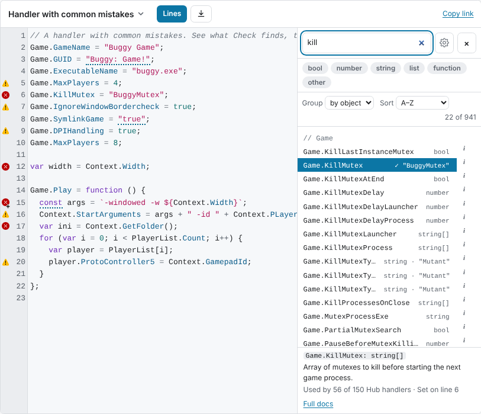

  

- **Tips while you write.** Loading-screen-style tips under the code, and a heads-up when the code makes one relevant (each shown once). Turn them off with ×.
- **Settings.** ⚙️ in the header: theme, text size, line wrap, symbol keys, tips and the Lines list; Advanced mode and the developer bar under Advanced.
- **Works on phones.** A slim header with a ⋯ menu, Lines full screen, wrapped lines and symbol keys above the on-screen keyboard.
  

Screenshot

  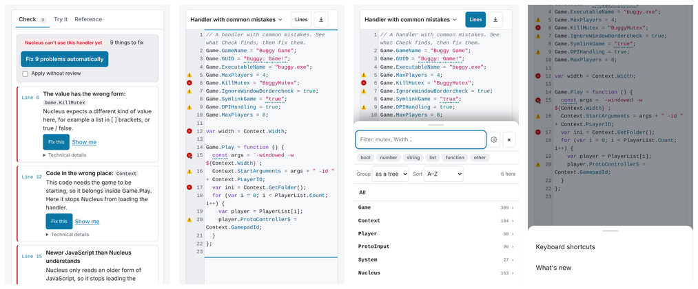

  

- **Intro page for testers.** [The intro page](https://snailedlt.github.io/nucleuscoop-handler-testbench/start/) has screenshots, the install guide and a download link that always points to the newest release.

### 🐛 Fixed

- **The Lines scrollbar no longer hides values.** On Windows it covered the values on the right. Reported by Horah.
- **Two false flags gone.** Found by checking all 600 Hub handlers: a syntax error on `let x` followed by `var x`, and a Proto Input warning on 11 handlers.

### 🙏 Thanks

- **messenils** for the idea of a list of every name, like Pawno's.
- **Horah** for reporting the scrollbar that hid values.

---

## 2026-11-02

### ✨ New

- **The workbench on GitHub Pages.** Rebuilt daily with the newest verified Hub handlers.
- **Share links.** Copy link puts the handler (or the selected lines) in the address.
- **The splitscreen.me look.** Light and dark.
- **Weekly check against the real engine.** Every verified Hub handler runs in Nucleus' script engine (Jint 2.11.58) and is compared with Try it.

---

## 2026-11-01

### ✨ New

- **First version.** Check a handler, fix it automatically, and Try it: what Nucleus sets up for each player.
