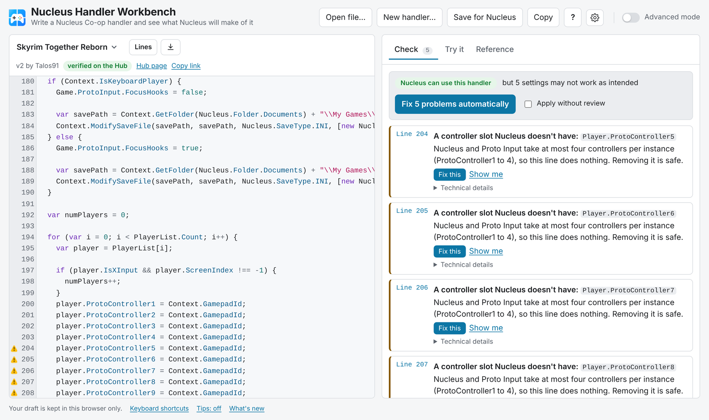
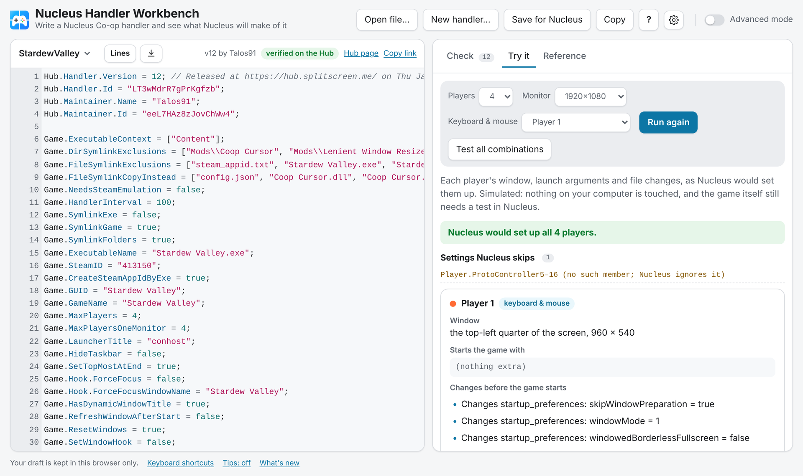
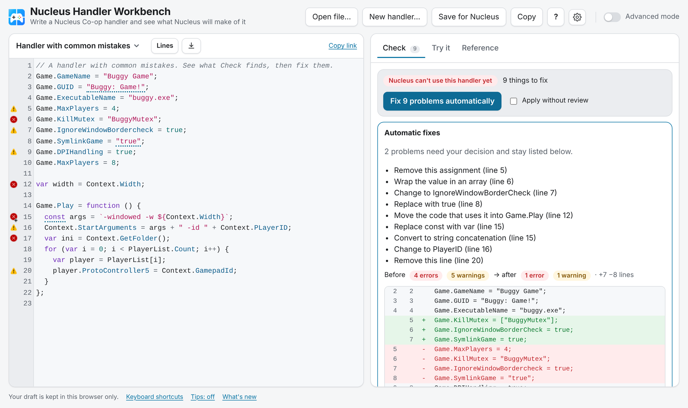
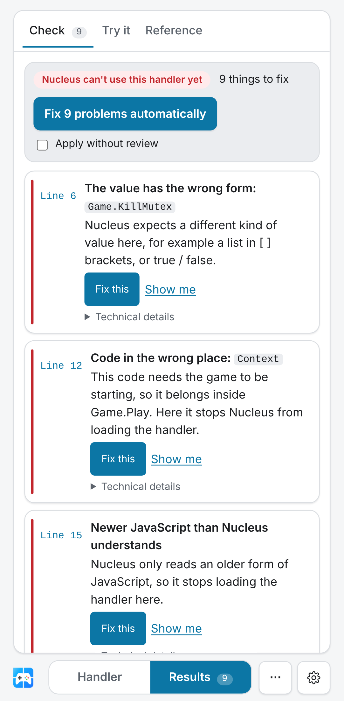

# Nucleus handler testbench

> **Beta, testers wanted.** Intro, screenshots and a 5-minute install: **https://snailedlt.github.io/nucleuscoop-handler-testbench/start/?ref=readme-md**

Runs [Nucleus Co-op](https://github.com/SplitScreen-Me/splitscreenme-nucleus) game handlers outside Nucleus, on Linux or macOS with Mono, using **the same JavaScript engine version Nucleus ships (Jint 2.11.58), set up the same way**. Use it to check that a handler loads and that its `Game.Play` logic runs for each player, without Windows, the game or controllers.

**Browser workbench: https://snailedlt.github.io/nucleuscoop-handler-testbench/?ref=readme-md** (from `playground/`): check a handler, fix it, and see what Nucleus sets up for each player, in the browser. Nothing to install.

<p>
  <picture><source media="(prefers-color-scheme: dark)" srcset="docs/images/check-dark.png"></picture>
  <picture><source media="(prefers-color-scheme: dark)" srcset="docs/images/try-it-dark.png"></picture>
</p>
<p>
  <picture><source media="(prefers-color-scheme: dark)" srcset="docs/images/fix-all-dark.png"></picture>
  <picture><source media="(prefers-color-scheme: dark)" srcset="docs/images/phone-dark.png"></picture>
</p>

## What it does

1. **Loads** each handler exactly like `GenericGameInfo`'s constructor in Nucleus:
   - same Jint version and `AllowClr` setup;
   - `var Nucleus = importNamespace('Nucleus.Gaming')`;
   - the same `\r\n` line doubling (error line numbers are halved, like Nucleus does).
2. **Runs `Game.Play` once per simulated player** (2 by default), like `PrePlay`/`CreateContext`. Each instance gets its own `Context`: window size, player ID, folders, options and prompt answers. `Game.ProtoInput.OnInputLocked`/`OnInputUnlocked` run too.
3. **Records instead of acting.** `Context.*` and `ProtoInput.*` calls are logged (`--verbose`) instead of editing files, the registry or processes.

`Game`, `Game.Hook`, `Game.ProtoInput`, the `Nucleus.*` enums, `IniSaveInfo`/`CfgSaveInfo` and `Hub` are **Nucleus' own source files**, used verbatim. `GenericGameInfo`, `GenericContext`, `PlayerInfo` and the `ProtoInput` runtime are **generated from the field and method declarations in Nucleus' source** (`tools/mkstubs.mjs`), so names, types, defaults and overloads match. Their method bodies only record calls.

Result per handler:

| Status | Meaning |
| --- | --- |
| `OK` / `LOADED` | Loads; `Game.Play` ran for every player (or there is none) |
| `LOAD-FAIL` | Nucleus would show "Error in handler" and not list the game |
| `PLAY-FAIL` | `Game.Play` (or an input-lock callback) throws, so instance setup would fail |
| `ENV` | Only failed because game files aren't present (`System.IO` on paths that don't exist here) |
| `HARNESS` | A problem in the testbench itself; please report it |

**Not covered:** anything that needs Windows, the game or input devices, such as window placement, focus, input routing, mutexes and LAN. That still needs a real play test in Nucleus.

## Setup

Requires Mono (`mcs`, `mono`), Node 18+, Python 3, git, curl and unzip. On Ubuntu:

```bash
sudo apt-get install mono-complete nodejs python3 git curl unzip
./setup.sh
```

`setup.sh` does the following:
- clones `splitscreenme-nucleus` at a pinned commit (`NUCLEUS_REF`);
- checks that it still uses Jint 2.11.58;
- downloads Jint and Newtonsoft.Json from NuGet;
- generates the stubs and builds `build/harness.exe`.

Nothing third-party is committed to this repo.

## Usage

```bash
# Your own handlers
./run.sh --own path/to/MyGame.js [--verbose]

# Handlers from hub.splitscreen.me (version-verified only, see below)
python3 -I tools/fetch_verified.py --limit 150        # or: --id <handlerId>
./run.sh --verified                                   # or: ./run.sh --verified <id>-v<N>.js

# Engine behaviour regression check
./test-probes.sh
```

**Hub index** (`.github/workflows/hub-sync.yml`, daily): the only place that reads hub.splitscreen.me's handler list. `tools/hub-sync.mjs` writes `hub-index.json` to the `data` branch (<https://raw.githubusercontent.com/Snailedlt/nucleuscoop-handler-testbench/data/hub-index.json>), and the workbench build, the weekly check and the extension's CLI, MCP server and Browse the Hub read that instead of the Hub API (which stays the fallback). Handler packages come from the Hub's storage, once per version. The same run mirrors every handler for the workbench (`tools/hub-mirror.mjs`): `hub/<id>.js`, `hub/packages.json`, the covers, and each package's other files (`hub/<id>.files.json` from `tools/hub-files.mjs`: small files with content, big ones by name and size; `HUB_MIRROR_PKG_MAX` package downloads a run, default 60), so Hub handlers open in the workbench with their whole package listed.

**Lines column usage counts** (`playground/src/usage.json`): how many Hub handlers use each API name, shown in the workbench's Lines column. Regenerate from handlers you already downloaded (`nucleus hub fetch`, one folder per handler) with `node tools/usage-counts.mjs <dir>`; only the counts are saved. Last taken from the 600 most-starred Hub handlers (before the index had all of them; rerun it to count every one).

**Nightly** (`.github/workflows/nightly.yml`, also on pushes to the harness, tools or probes): the probes in real Jint, Try it's parity on every probe, and every verified Hub handler run in real Jint (network isolated) and compared with Try it by `tools/compare-hub.mjs`: outcome, player 1's launch arguments, and lint errors. Last local run: 150 handlers, 91 comparable (the rest touch real files the harness can't provide), 91/91 outcomes and launch arguments agree, no lint errors. It also warns when Nucleus master moves past the commit the stubs are pinned to.

## Safety: only verified Hub handlers are run

Handlers get .NET access through Jint (`System.IO`, `System.Diagnostics`, …), so running one means trusting it.

- **`tools/fetch_verified.py`** admits a Hub handler only when, for the **exact version downloaded**:
  - the package's own `meta.verified` is true (the Hub verifies per package; a new upload resets it);
  - the package belongs to that handler and its `handlerVersion` matches the version downloaded;
  - the downloaded `handler.js` is identical to the verified package's `jsContent`.

  Admitted files are recorded with their SHA-256 in `downloads/verified-manifest.json`.
- **`run.sh --verified`** runs only files listed in that manifest whose hash still matches. **`run.sh --own`** refuses anything under `downloads/`. Don't copy Hub files elsewhere to get around this.
- **Isolation:** when `unshare -n` is available, the harness runs without network access, in a throwaway working directory and `HOME`.

## Workbench (browser GUI)

`playground/` builds a single self-contained page for testing by hand. It's published at **https://snailedlt.github.io/nucleuscoop-handler-testbench/?ref=readme-md** (`.github/workflows/pages.yml`: on every push and daily, against splitscreenme-vscode's `main`; one-time setup: Settings > Pages > Source: GitHub Actions). It has:

- an editor with live lint squiggles, quick fixes, completion, hover docs and signature help;
- API search;
- the New Handler generator;
- a per-player `Game.Play` simulation;
- the probes, shown next to the linter's verdict;
- **Engine templates**: the same files the SplitScreen.Me Discord bot sends with `/create`. They are read at build time from [splitscreenme-discordbot](https://github.com/SplitScreen-Me/splitscreenme-discordbot)'s `src/handler_templates`, using a cached shallow clone in `.cache/`. Pass `--bot <path>` to use a local checkout, or `--refresh-bot` to re-clone;
- **Hub examples**: the most-downloaded handlers whose current version is verified, snapshotted from the hub API at build time (`--hub <n>`, default 40; `--refresh-hub` to re-fetch). A published artifact can't reach other sites when you view it, so they are embedded. Each one's source is that verified package's own `jsContent`, and its package's other files are downloaded once per version (cached in `.cache/hub-files/`) for the Files panel;
- **Fix all problems**: the extension's deterministic, offline fixes, with a diff to review or **Apply automatically**;
- **Fix with AI**, only when the page runs inside a Claude viewer.

**Fix with AI** works like this:
- It calls Claude through the artifact `sample` capability, on the viewer's own account.
- Claude gets the page's linter and API lookup as tools, so it can check its own fix.
- The result is shown as a diff, with error and warning counts before and after. You choose **Accept** or **Reject**.
- In **Apply automatically** mode the fix is applied straight away, with **Undo**. It still goes to review if the fix adds any new problem, removes more than half the handler, doesn't reduce the problem count, or you edited the handler meanwhile.

**Advanced mode** is off by default. You turn it on with the switch at the top right.

- **Off:** problems in plain language with **Fix this** and **Show me**, a readable per-player preview ("Window: the left half of the screen, 960 × 1080", "Changes config.ini: Width = 960"), and **Save for Nucleus**. That saves a `.zip` you drag onto Nucleus Co-op's *Extract handler* button.
- **On:** rule ids, severity filters, the API reference, engine probes and recorded calls.

You can open handler `.js`, `.zip` or `.nc` files by picking them or dropping them on the page. Linting runs in a Web Worker so typing stays smooth in long handlers, and on phones a Handler / Results switch shows one pane at a time.

In Advanced mode everything is keyboard-driven:
- **Ctrl/⌘+K** opens one searchable list of starters, Hub handlers, probes and actions;
- **Ctrl/⌘+Enter** simulates;
- **Alt+Shift+F** fixes problems;
- **F8** / **Shift+F8** steps through problems;
- **?** lists the shortcuts.

**Theme and dev bar.** The page uses splitscreen.me's theme (brand blue, system fonts, light and dark). A dev bar, like lonnsinnplassering's, sets the colour mode and checks the WCAG contrast of the theme's text colours. Open it with Ctrl+Alt+D (remembered), a `#dev` link (this page load only), or "Show or hide the dev bar" under Examples… (Ctrl K).

**Share links.** **Share › Copy a link** puts the handler, compressed, into the link (`#share-…`), so anyone with the link sees the same code; with text selected it shares just the selection, which keeps links short enough for a Discord message (2,000 characters; whole handlers are usually longer).

Links like `#hub-<id>`, `#probe-17`, `#template-basic` or `#example-mistakes` open that example directly. The page also remembers your draft, the active tab and the simulation settings in your browser.

It uses the same core code as the extension, from a checkout of [splitscreenme-vscode](https://github.com/Snailedlt/splitscreenme-vscode). That checkout needs `npm ci` run in it first.

```bash
cd playground && npm install && node build.mjs --core ../../splitscreenme-vscode   # → dist/workbench.html
```

The simulation runs in the browser's JavaScript engine, not Jint. It emulates the Jint rules the probes confirmed, and it refuses code Jint can't parse. Before running a handler it rewrites the source so the browser behaves like Jint where they differ: ES2015+ built-ins Jint lacks (`.includes()`, `Object.assign`, `Map`, …) fail, `let`/`const` become `var`, and a top-level `"use strict"` applies to the whole handler.

The simulation lives in splitscreenme-vscode (`src/core/sim.ts`), where it also powers the extension's **Try it** panel and `nucleus simulate`; this page bundles the same file.

`sim-parity.mjs` checks the simulation against the real engine: it runs every probe through it and compares the outcome, and the launch arguments it produces, with `probes/expected.txt`. It currently matches on all 113. `--isolated` does the same through `nucleus simulate`, the sandboxed path the CLI and VS Code use. Run it after changing `src/core/sim.ts`:

```bash
cd playground && node sim-parity.mjs --core ../../splitscreenme-vscode              # and with --isolated
```

The page shows the same comparison live in Advanced mode → Engine probes.

## Probes

`probes/*.js` are tiny handlers that each pin down one engine behaviour handler tooling relies on. `probes/expected.txt` holds the reviewed results. Highlights from Jint 2.11.58:

- **`let`/`const` load but behave like `var`** (01, 02, 04): `const` can be reassigned, and `let` leaks out of its block. `const` in a `for` head fails to load (03).
- **Newer syntax fails to load:** arrow functions, template strings, a trailing comma in a call, `class`, `0b11`, `{ a }` shorthand, default parameters, `catch {}` (05–08, 31–34). Trailing commas in array/object literals are fine (35).
- **Unknown members:** writes are silently ignored and reads return `undefined` (09, 12). With `"use strict"` as the first statement, the write throws instead (38, 39).
- **Member names:** only the first letter is case-insensitive (11, 12). `Context.width` works; `Context.PLayerID` is `undefined`.
- **Conversions:**
  - `"False"`/`"True"` work for booleans (13);
  - `"100"` works for a number, and `12345` for a string (15, 16);
  - **a non-array value for an array option makes the handler fail to load** (14, 41).
- **`Game.DPIHandling = true` selects `Scaled`, and `false` selects `True`** (24, 40). Use the enum.
- **Globals:** `Context` at the top level fails to load (17); `typeof Context` is safe (18).
- **Nucleus re-joins the file line by line** with extra line breaks (107–109): a string continued with `\` no longer parses; other multi-line code is unaffected.
- **C# default parameter values are ignored** (110, 111): `Context.RandomString(8)` throws; pass every parameter.
- **Built-ins are ES5 only (42–106):** `padStart`/`padEnd` exist, but `.includes()`, `.startsWith()`, `.endsWith()`, `.repeat()`, `.find()`, `.findIndex()`, `.fill()`, `.flat()`, `.trimStart()`/`.trimEnd()`/`.trimLeft()`, `Object.assign`/`entries`/`values`, `Array.from`/`of`, `Number.isInteger`/`isNaN`/`parseInt`, `Math.trunc`/`sign`/`log10`, `Map`, `Set` and `WeakMap` throw when the code runs ("Object has no method …", "… is not defined"). `Promise`, `Symbol`, `Reflect`, `Proxy` and `Number.EPSILON` are `undefined`. The handler still loads, so only code that actually runs fails.
- **Method calls:**
  - a wrong argument count throws "No public methods with the specified arguments were found" (21, 22);
  - numbers and booleans are accepted for string parameters (20);
  - `params` methods accept an array or separate arguments (19);
  - `uint` IDs are accepted for enum parameters (23);
  - Proto Input enums are reachable as `Nucleus.SetWindowPosHook`, etc. (25).

## Layout

```
setup.sh                 fetch pinned inputs, generate stubs, build
run.sh                   run handlers (--own / --verified), sandboxed
test-probes.sh           engine behaviour regression check
src/Harness.cs           loader + per-player Game.Play runner
src/Globals.cs           stand-in for Nucleus' Globals paths
tools/mkstubs.mjs        C# stubs from Nucleus' real declarations
tools/csparse.mjs        C# member parser (from splitscreenme-vscode's scripts/generate-api.mjs)
tools/fetch_verified.py  version-verified Hub downloads + manifest
probes/                  engine behaviour probes + expected results
playground/              browser workbench (build.mjs → dist/workbench.html)
```
